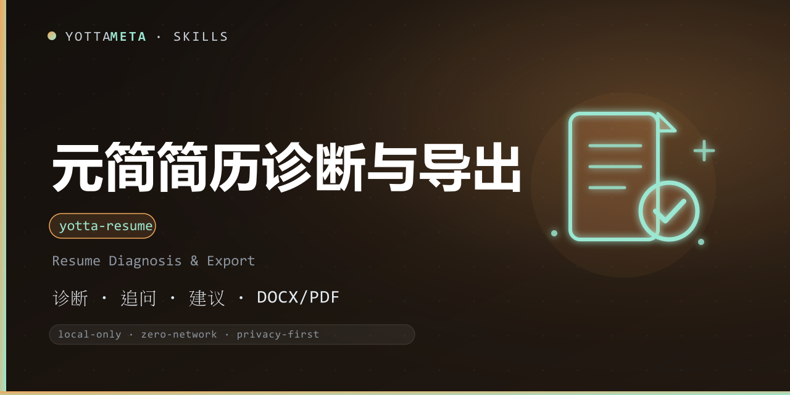

<p align="center"><b>Language</b>: English · <a href="./README.zh-CN.md">中文</a></p>

<p align="center"></p>

<h1 align="center">yotta-resume · Yuan Jian</h1>

<p align="center">Analyze a resume locally, ask for missing evidence, suggest factual improvements, and export DOCX/PDF.</p>

<p align="center">
  <a href="LICENSE"></a>
  <a href="https://www.npmjs.com/package/@yottameta/yotta-resume"></a>
  <a href="https://github.com/YottaMeta/yotta-resume"></a>
</p>

## What it is

yotta-resume is a job-seeker resume analysis and export tool. It reads Markdown,
UTF-8 text, DOCX, and text-layer PDF resumes, identifies sections, experience bullets,
metrics, contact information, and JD keyword gaps, then returns high-value questions
and improvement suggestions. After the job seeker confirms the facts, the same resume
can be exported to DOCX, HTML, or PDF.

The core analyzer uses the Python standard library. It makes no network requests,
does not submit resumes, and never invents experience or numbers. PDF input uses
local PyMuPDF and fails clearly when the dependency is missing or the file cannot
be parsed.

## When to use

- Review resume structure, evidence, and measurable outcomes.
- Compare a resume with a target job description.
- Prepare focused follow-up questions for missing facts.
- Export a confirmed resume as DOCX/PDF.

**Do not use it** to submit applications, fabricate experience, predict interviews or offers, evaluate protected personal attributes, or create complex design portfolios.

## Quick usage

```bash
# Analyze a resume and print a Markdown report
python scripts/yotta_resume.py audit --resume resume.md

# Analyze a text-layer PDF directly
python scripts/yotta_resume.py audit --resume resume.pdf

# Analyze with a JD and output JSON
python scripts/yotta_resume.py audit --resume resume.md --jd jd.txt --format json

# Export DOCX, HTML, and PDF
python scripts/yotta_resume.py export --input revised.md --docx revised.docx --html revised.html --pdf revised.pdf

# Validate role, question-bank, source, ledger, and dual-role contracts offline
python scripts/yotta_resume.py contracts --format json
```

PDF export requires a local Chromium, Chrome, or Edge browser. PDF input requires
`pip install pymupdf`. Missing browsers, missing PDF dependencies, encrypted files,
and image-only PDFs fail clearly instead of producing a misleading result.

The `readiness.score` field is a structural rule score only. It is not a recruiter
score. When no JD is provided, job-match coverage is `null`.

See [references/usage.md](references/usage.md) for input format, fields, and exit codes.
See [references/data-contracts.md](references/data-contracts.md) for the bundled data contracts.

## Installation

Choose one of the methods below. Skill files are distributed through **npm**; GitHub hosts source code and issues.

### Method 1: npm one-liner (recommended)

```text
npx -y @yottameta/yotta-resume --agent <agent-name>
npx -y @yottameta/yotta-resume --dir <agent-skills-dir>
```

- `--agent <name>` installs to that agent's default user-level skills directory.
- `--dir <path>` installs to a specified skills directory.
- `--list` shows supported agent defaults.
- If a China mirror has not synced the package, append `--registry=https://registry.npmjs.org/`.

### Method 2: git clone

```text
git clone https://github.com/YottaMeta/yotta-resume.git <agent-skills-dir>/yotta-resume
```

### Method 3: Download ZIP

Download the ZIP from `YottaMeta/yotta-resume`, then move the `yotta-resume` folder into your agent skills directory.

### Method 4: install.sh

```text
bash install.sh --agent <agent-name>
bash install.sh --dir <skills-dir>
bash install.sh --list
```

## Development and validation

```bash
python scripts/test_yotta_resume.py
python scripts/test_contract_validate.py
python -m py_compile scripts/yotta_resume.py scripts/contract_validate.py scripts/test_yotta_resume.py scripts/test_contract_validate.py
```

The current suite has 50 tests covering analysis, masking, questions, suggestions,
JD matching, Markdown/DOCX/PDF input, HTML escaping, PDF export, CLI behavior,
source manifests, numeric-output guardrails, role contracts, question sources,
evidence ledger rules, and dual-role permissions.

## License

MIT © YottaMeta — see [LICENSE](./LICENSE).
