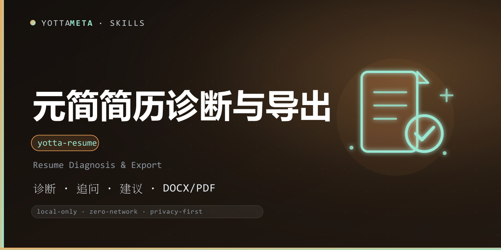

<p align="center"><b>Language</b>: <a href="./README.md">English</a> · 中文</p>

<p align="center"></p>

<h1 align="center">yotta-resume · 元简</h1>

<p align="center">本地分析简历、追问缺失事实、给出修改建议，并导出 DOCX/PDF。</p>

<p align="center">
  <a href="LICENSE"></a>
  <a href="https://www.npmjs.com/package/@yottameta/yotta-resume"></a>
  <a href="https://github.com/YottaMeta/yotta-resume"></a>
</p>

## 这是什么

元简是一个求职者简历分析与导出工具。它读取 Markdown、UTF-8 文本、DOCX
和文字层 PDF，识别章节、经历要点、量化指标、联系方式和 JD 关键词缺口，
输出高价值追问和修改建议；确认事实后，可以把同一份简历导出为 DOCX、HTML 或 PDF。

核心分析使用 Python 标准库，不发起网络请求，不自动投递简历，也不编造经历或数字。
PDF 输入需要本地 PyMuPDF；未安装、扫描件或文件损坏时会明确降级或失败。

## 何时使用

- 需要诊断简历结构、经历证据或量化指标。
- 需要根据目标岗位 JD 判断关键词覆盖。
- 需要整理应向求职者追问的高价值问题。
- 需要把已确认的简历导出为 DOCX/PDF。

**不要使用**：代投简历、编造经历、预测面试或 Offer 结果、评估受保护个人属性，或制作复杂设计作品集排版。

## 快速使用

```bash
# 分析简历，输出 Markdown 报告
python scripts/yotta_resume.py audit --resume resume.md

# 直接分析文字层 PDF
python scripts/yotta_resume.py audit --resume resume.pdf

# 结合 JD 分析，输出 JSON
python scripts/yotta_resume.py audit --resume resume.md --jd jd.txt --format json

# 导出 DOCX、HTML 和 PDF
python scripts/yotta_resume.py export --input revised.md --docx revised.docx --html revised.html --pdf revised.pdf

# 离线校验岗位族、题库、来源与双角色权限契约
python scripts/yotta_resume.py contracts --format json
```

PDF 输出需要本机 Chromium、Chrome 或 Edge。没有浏览器时命令会返回明确错误，
不会生成伪 PDF。PDF 输入需要 `pip install pymupdf`。

报告中的 `readiness.score` 只表示“结构准备度（规则分）”，不代表招聘方评分；
未提供 JD 时岗位覆盖为 `null`。不得把该分数改写成其他数值或主观数字区间。

输入格式、字段和退出码见 [references/usage.md](references/usage.md)；
数据契约见 [references/data-contracts.md](references/data-contracts.md)。

## 安装

以下四种方式任选；技能文件从 **npm** 获取，GitHub 供源码和 Issue 使用。

### 方式一：npm 一行装（推荐）

```text
npx -y @yottameta/yotta-resume --agent <智能体名称>
npx -y @yottameta/yotta-resume --dir <智能体的技能目录>
```

- `--agent <name>` 安装到该智能体默认用户级技能目录。
- `--dir <path>` 安装到指定技能目录。
- `--list` 查看已支持的智能体默认目录。
- 国内镜像未同步新包时，可追加 `--registry=https://registry.npmjs.org/`。

### 方式二：git clone

```text
git clone https://github.com/YottaMeta/yotta-resume.git <智能体的技能目录>/yotta-resume
```

### 方式三：GitHub ZIP

在 `YottaMeta/yotta-resume` 仓库选择 **Code → Download ZIP**，解压后把 `yotta-resume` 放入智能体技能目录。

### 方式四：install.sh

```text
bash install.sh --agent <智能体名称>
bash install.sh --dir <技能目录>
bash install.sh --list
```

## 开发与校验

```bash
python scripts/test_yotta_resume.py
python scripts/test_contract_validate.py
python -m py_compile scripts/yotta_resume.py scripts/contract_validate.py scripts/test_yotta_resume.py scripts/test_contract_validate.py
```

当前测试覆盖 50 项，包含分析、脱敏、追问、建议、JD 匹配、
Markdown/DOCX/PDF 读取、HTML 转义、PDF 导出、CLI、来源清单、数字护栏、
岗位族、题库来源、证据账本和双角色权限。

## 许可证

MIT © YottaMeta — 见 [LICENSE](./LICENSE)。
